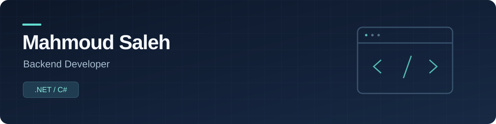

  

  <strong>Backend Developer (.NET / C#) · Community Leader @ NEC · C++ Instructor</strong> 
  Cairo, Egypt · Akhbar El-Youm Academy

  <a href="https://bodysale5678az-svg.github.io">Portfolio</a> &nbsp; / &nbsp;
  <a href="https://www.linkedin.com/in/mahmoud-saleh-b1a085362">LinkedIn</a> &nbsp; / &nbsp;
  <a href="mailto:bodysale5678az@gmail.com">Email</a>

## About

I build backend systems with **C# and .NET**, with a focus on clear application structure, object-oriented design and database modelling.

Alongside development, I lead the **NEC (Novera E-Club)** community and teach **C++, OOP and Data Structures** through the DSC activity.

## Selected work

<table>
<tr>
<td width="50%" valign="top">
<h3>01 / Clinic Management</h3>

<strong>ASP.NET Core MVC · EF Core · SQL Server</strong>

An Arabic RTL clinic app with role-based access, working-hours validation and appointment conflict prevention.

<a href="https://github.com/bodysale5678az-svg/hospital">View code →</a>

</td>
<td width="50%" valign="top">
<h3>02 / Sales Management</h3>

<strong>C# · .NET · OOP</strong>

A business domain model exploring Repository and Strategy patterns, payroll rules and an order state machine.

<a href="https://github.com/bodysale5678az-svg/SalesManagementSystem">View code →</a>

</td>
</tr>
<tr>
<td width="50%" valign="top">
<h3>03 / Smart Study Planner</h3>

<strong>C++17 · Winsock · JSON API</strong>

A study-task planner with a built-in HTTP server and an Arabic RTL web interface.

<a href="https://github.com/bodysale5678az-svg/SmartStudyPlanner">View code →</a>

</td>
<td width="50%" valign="top">
<h3>04 / SuperMarket Pro</h3>

<strong>C++17 · CMake · OOP</strong>

A learning project for inventory, role-based access and a point-of-sale flow with file persistence.

<a href="https://github.com/bodysale5678az-svg/SuperMarketPro">View code →</a>

</td>
</tr>
</table>

## Toolkit

| Focus | Technologies |
| :--- | :--- |
| Backend | C# · .NET · ASP.NET Core MVC |
| Data | Entity Framework Core · SQL Server |
| Also building with | C++ · Python · Git |

## Learning next

Clean Architecture with .NET · ASP.NET Core patterns · Data Structures & Algorithms

---

<strong>Always building. Always learning.</strong> 
<a href="https://bodysale5678az-svg.github.io">More projects on my portfolio →</a>

